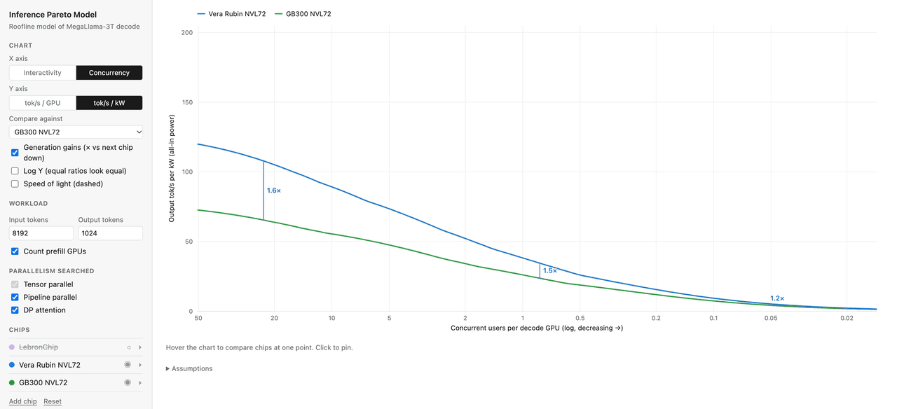

# Inference Pareto Model

**Try it: https://aryatsc.github.io/inference-pareto/**

A roofline model of LLM decode on GB300 NVL72, Vera Rubin NVL72, and a hypothetical next chip (LebronChip). For each chip it searches parallelism configs and plots the throughput–latency Pareto frontier.

([MP4](media/demo.mp4))

## What's modeled

**Model: MegaLlama-3T.** The Llama-3 architecture scaled up to about 3.05T parameters, dense:
- 240 layers, d = 32768, 256 query heads and 8 KV heads (GQA) with head dim 128
- SwiGLU FFN, 106496 wide; vocab 128256

**Precision:** NVFP4 weights and GEMMs (4.5 bits/param including scales), FP8 KV cache and attention, BF16 activations.

**Workload:**
- Fixed input and output lengths (default 8k in / 1k out).
- Prefill runs on a separate GPU pool and is compute-bound. Its GPU-seconds are charged to each request, so throughput per GPU counts both pools.

**Decode step:** each op costs `max(bytes / BW, FLOPs / peak)`, and time per output token is the sum over all ops in all layers. Per layer:
- QKV and output projections, run as weight-streaming GEMMs
- attention over the KV cache
- the SwiGLU FFN
- two collectives (after attention and after the FFN), which sit on the critical path
- a fixed overhead

Pipeline hops and the LM head are added on top.

**Parallelism searched:**
- Tensor parallel: every width that divides the NVLink domain.
- DP attention: attention TP of 1/2/4/8 with data parallelism across the rest of the TP group, and the FFN still TP over the whole group.
- Pipeline parallel: 1–8 stages, crossing to the scale-out network if a replica outgrows the NVLink domain.
- With only 8 KV heads, attention TP wider than 8 copies the KV cache instead of splitting it. That's what DP attention avoids.

A config is valid only if weights plus KV for the full context fit in 92% of HBM. The plotted line is the best valid config at each point.

**Achievable rates:** the same for every chip, and taken from public Blackwell measurements.

| Assumption | Value |
|---|---|
| HBM bandwidth | 85% of spec |
| Dense tensor FLOPs | 65% of spec |
| Link bandwidth | 90% of spec |
| NVLink collective | 3 µs each |
| NVLink send | 2 µs |
| Scale-out send | 5 µs |
| Fixed cost per layer | 1 µs |
| Decode GEMM token padding | multiple of 16 |

The *Speed of light* toggle shows 100% of spec with no padding and no per-layer overhead; link latencies are kept.

**Views:**
- X axis: interactivity (output tok/s per user), or concurrent users per decode GPU on a reversed log scale, so low latency is on the right in both.
- Y axis: output tok/s per GPU, or per kW of all-in power.
- The "×" markers give each chip's throughput gain over the next chip down the list, at three points along the frontier.

## Chip specs (per GPU package)

| | Dense FP4 | Dense FP8 | HBM | HBM BW | NVLink (bidir) | NVLink domain | NIC | All-in W/GPU |
|---|---|---|---|---|---|---|---|---|
| GB300 NVL72 | 15 PF | 5 PF | 288 GB | 8 TB/s | 1.8 TB/s | 72 | 800 Gb/s | ~1,900 |
| Vera Rubin NVL72 | 35 PF | 17.5 PF | 288 GB | 19.2 TB/s | 3.0 TB/s | 72 | 1.6 Tb/s | ~2,640 |
| LebronChip | Rubin × (Rubin ÷ GB300) for every spec, NVLink domain unchanged | | | | | | | |

Sources and caveats:
- **NVIDIA product pages** for GB300 NVL72 and Vera Rubin NVL72, as of Nov 2026.
- **Rubin revision:** Rubin's HBM4 and NVLink figures are the revised ones from Oct 2026 (19.2 TB/s, 3.0 TB/s).
- **Rubin FP4:** uses the dense 35 PF figure. The 50 PF "inference" number relies on adaptive compression.
- **Power:** rack power ÷ 72. That's about 137 kW for GB300 NVL72 (OEM figures) and about 190 kW for VR NVL72 Max-Q (SemiAnalysis / Kuo estimates). Neither figure is official.

Every spec is editable in the page, and you can add your own chips. The full state is kept in the URL, so any view can be shared as a link.

## What it doesn't model

MoE and expert parallelism, speculative decoding, prefill/decode interference (it assumes disaggregated serving), TTFT, KV offload, and real-world software maturity. Every chip is assumed to get equally good kernels.

## Run locally

It's a static page with no build step: `python3 -m http.server` in this folder, then open `http://localhost:8000`. All of the math is in [`model.js`](model.js).
